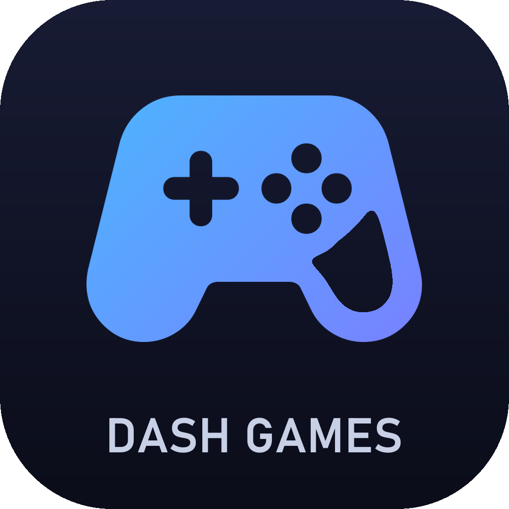
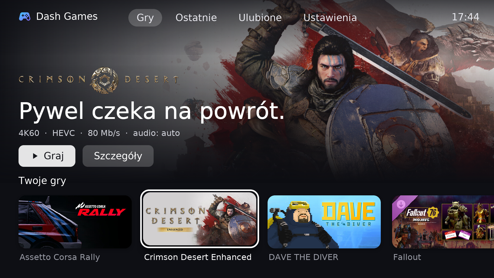
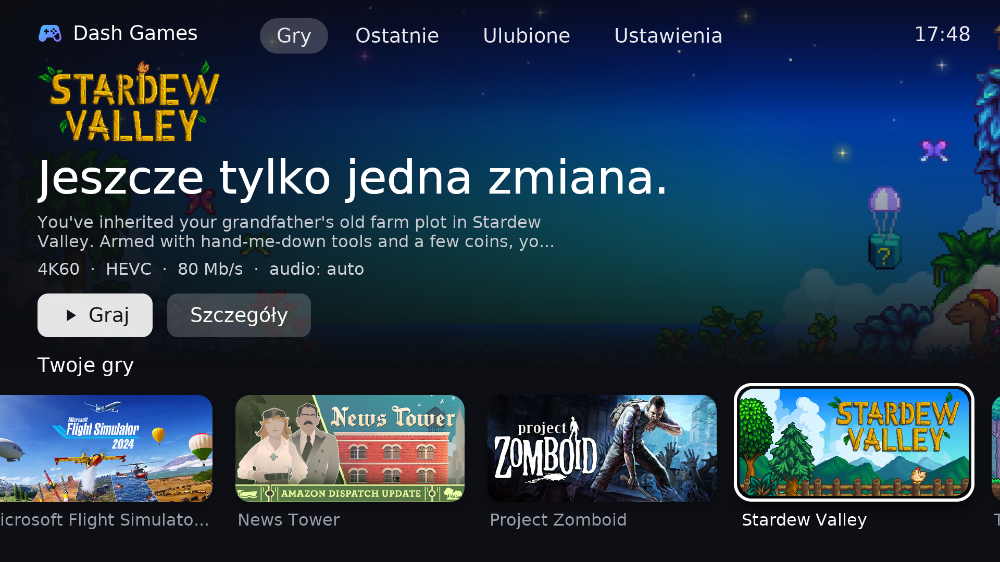
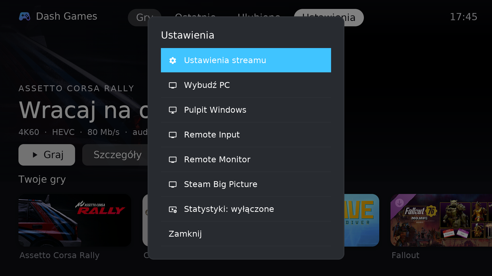

# Dash Games

**Dash Games** is a game streaming app for LG webOS TVs, based on [Moonlight TV](https://github.com/mariotaku/moonlight-tv). It streams games from your PC (Sunshine / Apollo / Vibepollo) to the TV, with a home screen modelled on Apple TV.

## Compared to Moonlight TV

**Audio fix for Vibepollo 2.0.3+**
- Moonlight TV always asks the host for `continuousAudio`. On Vibepollo 2.0.3 and newer this produces crackling, "robotic" audio.
- Dash Games doesn't send that request, so the audio is clean.
- Background: [Nonary/Vibepollo#703](https://github.com/Nonary/Vibepollo/issues/703). Upstream fix: [mariotaku/moonlight-tv#641](https://github.com/mariotaku/moonlight-tv/pull/641).

**Home screen**
- Full-screen Steam artwork for the selected game, with the game's logo and a short tagline.
- A short description from the Steam store, in Polish where available.
- A row of game tiles using Steam artwork, with the game name under each tile.
- Apps that have no Steam artwork get a tile built from their own cover, placed on a blurred background.

**Tabs**
- **Gry** (games), **Ostatnie** (recently played), **Ulubione** (favourites).
- **Ustawienia** (settings) opens a menu with: stream settings, wake the PC, Windows desktop, Steam Big Picture, Remote Input / Monitor, and a toggle for connection stats.

**Safer launching**
- When a game is already running on the PC, the home screen shows **Wznów / Zakończ grę** (resume / quit game).
- Starting a different game first asks you to confirm.

**During a stream**
- Long-press BACK to open the overlay. It now has a **Settings** button.
- Connection stats can stay visible while you play.

**Defaults:** 4K, 60 FPS, HEVC, 80 Mb/s.

## Installation

1. Your TV needs Developer Mode or Homebrew Channel.
2. Download the `.ipk` file from [Releases](../../releases).
3. Install it with `ares-install com.dashgames.tv_*.ipk`, or through webOS Dev Manager.

The app installs next to Moonlight TV as a separate app (`com.dashgames.tv`). The first time you connect, you pair it with the host using a PIN.

## Building

Builds use GitHub Actions (the `Build (webOS)` workflow).

## License and credits

- Based on [Moonlight TV](https://github.com/mariotaku/moonlight-tv) by Mariotaku and contributors, and licensed, like the original, under **GPL-3.0** (see `LICENSE`).
- The original README is in [docs/README.moonlight-tv.md](docs/README.moonlight-tv.md).
- Icons come from [Material Symbols](https://fonts.google.com/icons) (Apache 2.0).
- Game artwork is downloaded from the Steam store at runtime. It is not included in this repository.
